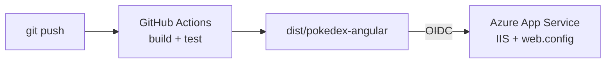

# Despliegue de la PokeDex en Azure App Service

Guía para publicar la aplicación **PokeDex** (Angular 14) en **Azure App Service (Windows)** con despliegue automático mediante **GitHub Actions** y encabezados de seguridad HTTP.

> **Requisito:** tener la cuenta de Azure y el App Service creados, según el [README.md](README.md).

**URL:** https://app-pokedex-prod-rkeyy7-e7edh5bah5aje7g2.mexicocentral-01.azurewebsites.net



---

## 1. Preparar el repositorio

1. Crea en GitHub el repositorio público `pokedex` (con README y `.gitignore` de Node) y clónalo:

```bash
git clone https://github.com/<tu-usuario>/pokedex.git
cd pokedex
```

2. Copia el **contenido** de `source/pokedex-angular/` a la raíz del repositorio, **excepto** `node_modules/`, `.angular/` y `.github/`.
3. Usa el `.gitignore` del proyecto Angular (incluye `/dist`, `/node_modules` y `/.angular/cache`).
4. Sube el código original:

```bash
git add .
git commit -m "Código fuente original de PumasLab"
git push
```

> El proyecto usa **Commitizen**: al ejecutar `git commit` sin `-m` se abre un asistente de Conventional Commits. Ejecuta los comandos de uno en uno.

---

## 2. Compilar localmente

Con **Node.js 22 LTS**:

```bash
npm ci          # instala exactamente las versiones de package-lock.json
npm run build   # genera dist/pokedex-angular
```

> Las advertencias de *budgets* (tamaño del bundle) no impiden el build.

---

## 3. Configurar la seguridad del App Service

Portal → App Service → **Settings → Configuration → General settings**:

| Opción | Valor |
|---|---|
| HTTPS only | On |
| Minimum Inbound TLS Version | 1.3 |
| SCM Minimum Inbound TLS Version | 1.3 |
| SCM / FTP Basic Auth Publishing Credentials | Off |
| FTP state | Disabled |
| HTTP version | 2.0 |
| Session affinity | Off |
| Remote debugging | Off |

Guarda con **Save**. Comprueba que `http://` redirige a `https://`.

---

## 4. Conectar GitHub con Azure

Portal → App Service → **Deployment → Deployment Center → Settings**:

| Opción | Valor |
|---|---|
| Source | GitHub |
| Repository / Branch | `pokedex` / `main` |
| Workflow option | Add a workflow |
| Authentication type | User-assigned identity |

Al guardar, Azure crea `.github/workflows/main_<nombre-app>.yml` en el repositorio. La autenticación usa **OIDC** (token temporal), sin contraseñas.

1. En GitHub → **Actions**, **cancela** la primera ejecución (el workflow aún no está adaptado y sus pruebas no terminan).
2. Trae el workflow:

```bash
git pull
```

---

## 5. Aplicar los cambios de despliegue

Haz todos estos cambios y súbelos juntos en el [paso 6](#6-publicar-en-un-solo-commit).

### 5.1 Ruta de imágenes

`src/environments/environment.prod.ts` (la app se publica en la raíz del dominio, no en la subcarpeta de GitHub Pages):

```diff
- imagesPath: '/pokedex-angular/assets/images',
+ imagesPath: '/assets/images',
```

### 5.2 Workflow

En `.github/workflows/main_<nombre-app>.yml`:

| Cambio | Motivo |
|---|---|
| `actions/setup-node@v3` → `@v4` | Versión vigente |
| `npm install` → `npm ci` | Instalación reproducible |
| `npm run test` → `npm run test:cov` | `test` queda en modo watch; `test:cov` ejecuta una vez en Chrome headless |
| `path: .` → `path: dist/pokedex-angular` | Publicar solo el build |

Job `build` resultante:

```yaml
    steps:
      - uses: actions/checkout@v4

      - name: Set up Node.js version
        uses: actions/setup-node@v4
        with:
          node-version: '22.x'

      - name: npm ci, build, and test
        run: |
          npm ci
          npm run build
          npm run test:cov

      - name: Upload artifact for deployment job
        uses: actions/upload-artifact@v4
        with:
          name: node-app
          path: dist/pokedex-angular
```

> El job `deploy` no se modifica. Respeta la sangría: en YAML los espacios definen la estructura.

### 5.3 web.config

Crea `src/web.config`:

```xml
<?xml version="1.0" encoding="utf-8"?>
<configuration>
  <system.webServer>

    <!-- Rutas de la SPA: devuelve index.html si el archivo no existe -->
    <rewrite>
      <rules>
        <rule name="Angular SPA" stopProcessing="true">
          <match url=".*" />
          <conditions logicalGrouping="MatchAll">
            <add input="{REQUEST_FILENAME}" matchType="IsFile" negate="true" />
            <add input="{REQUEST_FILENAME}" matchType="IsDirectory" negate="true" />
          </conditions>
          <action type="Rewrite" url="/index.html" />
        </rule>
      </rules>
    </rewrite>

    <!-- Encabezados de seguridad -->
    <httpProtocol>
      <customHeaders>
        <remove name="X-Powered-By" />
        <add name="Strict-Transport-Security" value="max-age=31536000; includeSubDomains" />
        <add name="X-Content-Type-Options" value="nosniff" />
        <add name="X-Frame-Options" value="DENY" />
        <add name="Referrer-Policy" value="strict-origin-when-cross-origin" />
        <add name="Permissions-Policy" value="camera=(), microphone=(), geolocation=(), payment=(), usb=()" />
        <add name="Content-Security-Policy" value="default-src 'self'; script-src 'self'; style-src 'self' 'unsafe-inline' https://fonts.googleapis.com; font-src 'self' https://fonts.gstatic.com; img-src 'self' data: https://assets.pokemon.com; connect-src 'self' https://pokeapi.co https://beta.pokeapi.co; object-src 'none'; base-uri 'self'; form-action 'self'; frame-ancestors 'none'; upgrade-insecure-requests" />
      </customHeaders>
    </httpProtocol>

    <!-- Oculta el encabezado Server -->
    <security>
      <requestFiltering removeServerHeader="true" />
    </security>

    <staticContent>
      <remove fileExtension=".woff2" />
      <mimeMap fileExtension=".woff2" mimeType="font/woff2" />
    </staticContent>

  </system.webServer>
</configuration>
```

| Encabezado | Protege contra |
|---|---|
| Strict-Transport-Security | Conexiones sin cifrar (*SSL stripping*) |
| X-Content-Type-Options | *MIME sniffing* |
| X-Frame-Options | *Clickjacking* |
| Referrer-Policy | Filtración de URL a otros sitios |
| Permissions-Policy | Uso indebido de cámara, micrófono, ubicación, etc. |
| Content-Security-Policy | *Cross-Site Scripting* (XSS) |

**Sobre la CSP:** solo permite recursos propios y los orígenes externos que usa la app (Google Fonts, PokéAPI y `assets.pokemon.com`). `script-src 'self'` bloquea JavaScript inyectado. `style-src` incluye `'unsafe-inline'` porque Angular 14 inyecta los estilos de los componentes en tiempo de ejecución.

### 5.4 Eliminar código en línea de GitHub Pages

La CSP bloquea scripts en línea, así que:

1. En `src/index.html`, elimina el bloque entre `<!-- Start Single Page Apps for GitHub Pages -->` y `<!-- End Single Page Apps for GitHub Pages -->`.
2. Elimina `src/404.html`.

### 5.5 angular.json

En `architect > build > options > assets`, quita `src/404.html` y agrega `src/web.config`:

```json
"assets": ["src/favicon.ico", "src/og-image.jpg", "src/assets", "src/web.config"],
```

En `configurations > production`, agrega antes de `"budgets"` (evita CSS y `onload` en línea en `index.html`):

```json
"optimization": {
  "scripts": true,
  "styles": { "minify": true, "inlineCritical": false },
  "fonts": true
},
```

---

## 6. Publicar en un solo commit

1. Verifica localmente:

```bash
npm run build
```

En `dist/pokedex-angular` debe estar `web.config`, no debe estar `404.html`, y `index.html` no debe tener scripts ni `onload` en línea.

2. Revisa los cambios con `git status`. Deben aparecer:

```
modified:   .github/workflows/main_<nombre-app>.yml
modified:   angular.json
deleted:    src/404.html
modified:   src/environments/environment.prod.ts
modified:   src/index.html
new file:   src/web.config
```

3. Sube todo en un commit:

```bash
git add .
git commit      # feat(deploy): adapta la aplicacion para azure app service
git push
```

El push lanza el workflow. En **Actions**, `build` y `deploy` deben terminar en verde (unos 5 minutos).

---

## 7. Verificar

**Aplicación** (en incógnito, con F12 → Console):

- [ ] La lista, la búsqueda y el detalle cargan con sus imágenes.
- [ ] La URL directa `/pokemon/3` funciona.
- [ ] La consola no muestra errores *"Refused to..."* de la CSP.

**Seguridad:**

| Herramienta | Resultado |
|---|---|
| [securityheaders.com](https://securityheaders.com) | **A+** (6 de 6 encabezados) |
| [SSL Labs](https://www.ssllabs.com/ssltest/) | **A** (TLS 1.3 y HSTS detectados) |

---

## 8. Despliegues posteriores

```bash
git pull
# cambios en el código
npm run build
git add .
git commit
git push
```

Cada push a `main` despliega automáticamente. Para redesplegar sin cambios: **Actions → Run workflow**.

<!--stackedit_data:
eyJoaXN0b3J5IjpbLTEyMjg1Mzc0NDcsNzgzMzUxMTQzLDY5MT
E2MjM1MCwxMTM0MDU4NjQ3XX0=
-->