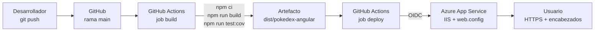

# Despliegue de la PokeDex en Azure App Service

Tutorial para publicar la aplicación **PokeDex** en **Azure App Service** de forma segura, con despliegue automático mediante **GitHub Actions** y encabezados de seguridad HTTP.

> **Requisito:** tener creada la cuenta Azure for Students y el App Service, como se explica en el [README.md](README.md).

---

## Tabla de contenido

1. [Visión general](#1-visión-general)
2. [Preparar el repositorio](#2-preparar-el-repositorio)
3. [Compilar y probar localmente](#3-compilar-y-probar-localmente)
4. [Adaptar el código a Azure](#4-adaptar-el-código-a-azure)
5. [Configurar la seguridad de la plataforma](#5-configurar-la-seguridad-de-la-plataforma)
6. [Configurar el despliegue continuo](#6-configurar-el-despliegue-continuo)
7. [Configurar IIS con web.config](#7-configurar-iis-con-webconfig)
8. [Content-Security-Policy](#8-content-security-policy)
9. [Verificar el despliegue](#9-verificar-el-despliegue)
10. [Operación y mantenimiento](#10-operación-y-mantenimiento)

---

## 1. Visión general

| | |
|---|---|
| **Aplicación** | Angular 14 (SPA) que consume la PokéAPI (REST y GraphQL) |
| **Hosting** | Azure App Service, Windows (IIS), plan Free F1 |
| **CI/CD** | GitHub Actions con autenticación OIDC (sin contraseñas) |
| **URL** | https://app-pokedex-prod-rkeyy7-e7edh5bah5aje7g2.mexicocentral-01.azurewebsites.net |

### Flujo de despliegue



Una vez configurado, cada `git push` a la rama `main` compila, prueba y publica la aplicación automáticamente en unos **5 minutos**.

---

## 2. Preparar el repositorio

### 2.1 Crear el repositorio

1. En GitHub, haz clic en **New repository**.
2. Configura:
   - **Repository name:** `pokedex`
   - **Visibility:** Public
   - **Add README:** activado
   - **Add .gitignore:** Node
3. Haz clic en **Create repository** y clónalo:

```bash
git clone https://github.com/<tu-usuario>/pokedex.git
cd pokedex
```

### 2.2 Agregar el código fuente

1. Descarga el código de la PokeDex (carpeta `source/pokedex-angular/` del repositorio de PumasLab).
2. Copia el **contenido** de esa carpeta a la **raíz** de tu repositorio, de modo que `package.json` y `angular.json` queden al mismo nivel que el `README.md`.
3. **No copies** estas carpetas si existen:

| Carpeta | Motivo |
|---|---|
| `node_modules/` | Dependencias (cientos de MB). Se regeneran con `npm ci`. |
| `.angular/` | Caché de compilación local. |
| `.github/` | Workflows del autor original para GitHub Pages; se reemplazarán por el de Azure. |

4. Reemplaza tu `.gitignore` por el del proyecto Angular. Verifica que incluya:

```gitignore
/dist
/node_modules
/.angular/cache
```

5. Sube el código:

```bash
git add .
git commit -m "Código fuente original de PumasLab"
git push
```

### 2.3 Convención de commits

El proyecto incluye **husky** y **Commitizen**, que aplican la convención **Conventional Commits**. Al ejecutar `git commit` (sin `-m`), un asistente solicita:

| Pregunta | Ejemplo |
|---|---|
| Tipo de cambio | `feat`, `fix`, `ci`, `docs` |
| Alcance | `security`, `workflow` |
| Descripción corta | `agrega encabezados de seguridad` |

Resultado: `feat(security): agrega encabezados de seguridad`.

> **Consejo:** ejecuta los comandos de uno en uno. Si pegas varios a la vez, el asistente interactivo toma los siguientes comandos como respuestas.

---

## 3. Compilar y probar localmente

### 3.1 Versión de Node.js

Usa **Node.js 22 LTS**. Aunque Angular 14 fue diseñado para Node 14/16, esas versiones ya no reciben actualizaciones de seguridad, y el build de producción funciona correctamente con Node 22.

```bash
node -v   # v22.x
```

### 3.2 Instalar dependencias

```bash
npm ci
```

`npm ci` (**clean install**) instala **exactamente** las versiones de `package-lock.json`, sin modificarlo, y crea `node_modules` desde cero. Es el comando recomendado para despliegues porque garantiza la **reproducibilidad**: tu equipo y el servidor de CI instalan lo mismo.

### 3.3 Compilar para producción

```bash
npm run build
```

El resultado queda en **`dist/pokedex-angular`** (propiedad `outputPath` de `angular.json`). Es la carpeta que se publica en Azure.

> Las advertencias de *budgets* (tamaño del bundle) son recomendaciones de rendimiento y no impiden el build.

### 3.4 Revisar las vulnerabilidades de dependencias

```bash
npm audit              # todas las dependencias
npm audit --omit=dev   # solo las que llegan al navegador
```

- **`devDependencies`** (herramientas de compilación y pruebas) no llegan al navegador del usuario.
- **`dependencies`** (Angular, Apollo, etc.) forman parte de la aplicación publicada.

Resultado: **124** vulnerabilidades en total y **[COMPLETAR]** en dependencias de producción.

> No ejecutes `npm audit fix --force`: actualiza paquetes saltando versiones mayores (por ejemplo, Angular) y rompe la aplicación. La solución definitiva es migrar a una versión vigente de Angular.

---

## 4. Adaptar el código a Azure

El código original se publicaba en GitHub Pages, bajo una subcarpeta. En Azure, la aplicación se publica en la **raíz** del dominio.

Angular usa un archivo de configuración por entorno; en producción, `environment.ts` se reemplaza por `environment.prod.ts` (sección `fileReplacements` de `angular.json`). Corrige la ruta de imágenes en **`src/environments/environment.prod.ts`**:

```diff
- imagesPath: '/pokedex-angular/assets/images',
+ imagesPath: '/assets/images',
```

Sube el cambio:

```bash
git add .
git commit
git push
```

---

## 5. Configurar la seguridad de la plataforma

Antes de publicar, configura el App Service para **reducir la superficie de ataque**.

En el portal: tu App Service → **Settings → Configuration → General settings → Platform settings**.

| Opción | Valor | Justificación |
|---|---|---|
| **HTTPS only** | On | Redirige todo el tráfico `http://` a `https://`. |
| **Minimum Inbound TLS Version** | 1.3 | Rechaza versiones antiguas del protocolo con vulnerabilidades conocidas. |
| **SCM Minimum Inbound TLS Version** | 1.3 | Aplica la misma exigencia al canal de administración y despliegue (SCM/Kudu). |
| **SCM Basic Auth Publishing Credentials** | Off | El canal de despliegue no acepta usuario y contraseña. |
| **FTP Basic Auth Publishing Credentials** | Off | Igual para FTP. |
| **FTP state** | Disabled | Cierra un canal de acceso que no se usa. |
| **HTTP version** | 2.0 | Mejor rendimiento. |
| **Session affinity** | Off | Evita una cookie innecesaria: la aplicación no guarda estado en el servidor. |
| **Remote debugging** | Off | La depuración remota no debe estar habilitada en producción. |

Haz clic en **Save** y confirma con **Continue** (Azure reinicia la aplicación automáticamente).

**Comprobación:** abre tu dominio con `http://`. El navegador debe redirigirte a `https://`.

Este enfoque aplica **defensa en profundidad**: varias capas de protección (plataforma, transporte y navegador), de modo que si una falla, las demás siguen protegiendo.

---

## 6. Configurar el despliegue continuo

### 6.1 Conectar GitHub desde el Deployment Center

1. En tu App Service: **Deployment → Deployment Center → Settings**.
2. Configura:

| Opción | Valor |
|---|---|
| Source | GitHub (autoriza el acceso a tu cuenta) |
| Organization | tu usuario |
| Repository | `pokedex` |
| Branch | `main` |
| Workflow option | Add a workflow |
| Authentication type | **User-assigned identity** |

3. Haz clic en **Save**.

Azure crea el archivo `.github/workflows/main_<nombre-app>.yml` mediante un commit en tu repositorio. Tráelo a tu equipo:

```bash
git pull
```

### 6.2 Autenticación sin contraseñas (OIDC)

Como la autenticación básica está deshabilitada, el despliegue no usa contraseñas. Azure crea una **identidad administrada** y guarda tres identificadores como *secrets* del repositorio (cliente, tenant y suscripción).

El permiso `id-token: write` permite que GitHub emita un **token temporal firmado** (JWT) que demuestra que la ejecución proviene de tu repositorio y rama. Azure confía en ese token mediante una **credencial federada (OIDC)**. El token dura minutos, así que **no existe ninguna credencial permanente que pueda filtrarse**.

### 6.3 Ajustar el workflow

El workflow que genera Azure es genérico para Node. Edítalo con estos cambios:

| Cambio | Motivo |
|---|---|
| `actions/setup-node@v3` → `@v4` | Versión vigente de la acción. |
| `npm install` → `npm ci` | Instalación reproducible. |
| `npm run test` → `npm run test:cov` | El script `test` se ejecuta en **modo watch** (queda esperando cambios y nunca termina). `test:cov` usa `--no-watch` y un Chrome **headless** (sin interfaz gráfica), adecuado para servidores. |
| `path: .` → `path: dist/pokedex-angular` | Publica solo el resultado del build, no todo el repositorio. |

> **Cuidado con la sangría:** en YAML los espacios definen la estructura. Mantén la misma sangría del archivo original.

### 6.4 Workflow final

```yaml
name: Build and deploy Node.js app to Azure Web App - app-pokedex-prod-rkeyy7

on:
  push:
    branches:
      - 'main'
  workflow_dispatch:          # permite lanzar el despliegue manualmente

jobs:
  build:
    runs-on: windows-latest
    permissions:
      contents: read

    steps:
      - uses: actions/checkout@v4

      - name: Set up Node.js version
        uses: actions/setup-node@v4
        with:
          node-version: '22.x'

      - name: npm ci, build, and test
        run: |
          npm ci
          npm run build
          npm run test:cov

      - name: Upload artifact for deployment job
        uses: actions/upload-artifact@v4
        with:
          name: node-app
          path: dist/pokedex-angular   # solo el resultado del build

  deploy:
    runs-on: ubuntu-latest
    needs: build                       # solo se ejecuta si build termina bien
    permissions:
      id-token: write                  # necesario para OIDC
      contents: read

    steps:
      - name: Download artifact from build job
        uses: actions/download-artifact@v4
        with:
          name: node-app

      - name: Login to Azure
        uses: azure/login@v2
        with:
          client-id: ${{ secrets.AZUREAPPSERVICE_CLIENTID_... }}
          tenant-id: ${{ secrets.AZUREAPPSERVICE_TENANTID_... }}
          subscription-id: ${{ secrets.AZUREAPPSERVICE_SUBSCRIPTIONID_... }}

      - name: 'Deploy to Azure Web App'
        uses: azure/webapps-deploy@v3
        with:
          app-name: 'app-pokedex-prod-rkeyy7'
          slot-name: 'Production'
          package: .
```

> Los nombres de los *secrets* los genera Azure automáticamente; conserva los de tu archivo.

**Cómo funciona:**

- **`on`:** se ejecuta con cada push a `main` o manualmente (`workflow_dispatch`).
- **Job `build`:** descarga el código, instala Node 22, instala dependencias, compila y ejecuta las **51 pruebas unitarias**. Si alguna prueba falla, el despliegue se detiene (*quality gate*). Al final empaqueta `dist/pokedex-angular` como **artefacto**.
- **Job `deploy`:** depende de `build` (`needs`). Como los jobs corren en máquinas distintas, el artefacto es la forma de pasar los archivos. Inicia sesión en Azure con OIDC y publica.

Sube el workflow:

```bash
git add .
git commit      # tipo: ci, alcance: workflow
git push
```

En la pestaña **Actions** de GitHub verás la ejecución. Debe terminar con **build** y **deploy** en verde en unos 5 minutos.

---

## 7. Configurar IIS con web.config

App Service Windows usa **IIS**, que lee un archivo `web.config` en la raíz del sitio. Con él se resuelven dos necesidades:

1. **Rutas de la SPA:** al abrir o recargar directamente una ruta como `/pokemon/3`, el navegador pide al servidor un archivo con ese nombre, que no existe. Sin configuración, IIS responde **404**.
2. **Encabezados de seguridad.**

### 7.1 Crear `src/web.config`

```xml
<?xml version="1.0" encoding="utf-8"?>
<configuration>
  <system.webServer>

    <!-- 1. Enrutamiento de la SPA -->
    <rewrite>
      <rules>
        <rule name="Angular SPA" stopProcessing="true">
          <match url=".*" />
          <conditions logicalGrouping="MatchAll">
            <add input="{REQUEST_FILENAME}" matchType="IsFile" negate="true" />
            <add input="{REQUEST_FILENAME}" matchType="IsDirectory" negate="true" />
          </conditions>
          <action type="Rewrite" url="/index.html" />
        </rule>
      </rules>
    </rewrite>

    <!-- 2. Encabezados de seguridad -->
    <httpProtocol>
      <customHeaders>
        <remove name="X-Powered-By" />
        <add name="Strict-Transport-Security" value="max-age=31536000; includeSubDomains" />
        <add name="X-Content-Type-Options" value="nosniff" />
        <add name="X-Frame-Options" value="DENY" />
        <add name="Referrer-Policy" value="strict-origin-when-cross-origin" />
        <add name="Permissions-Policy" value="camera=(), microphone=(), geolocation=(), payment=(), usb=()" />
        <add name="Content-Security-Policy" value="default-src 'self'; script-src 'self'; style-src 'self' 'unsafe-inline' https://fonts.googleapis.com; font-src 'self' https://fonts.gstatic.com; img-src 'self' data: https://assets.pokemon.com; connect-src 'self' https://pokeapi.co https://beta.pokeapi.co; object-src 'none'; base-uri 'self'; form-action 'self'; frame-ancestors 'none'; upgrade-insecure-requests" />
      </customHeaders>
    </httpProtocol>

    <!-- 3. Ocultar la tecnología del servidor -->
    <security>
      <requestFiltering removeServerHeader="true" />
    </security>

    <!-- 4. Tipo MIME para las fuentes -->
    <staticContent>
      <remove fileExtension=".woff2" />
      <mimeMap fileExtension=".woff2" mimeType="font/woff2" />
    </staticContent>

  </system.webServer>
</configuration>
```

### 7.2 Qué hace cada bloque

**Bloque 1, reescritura:** si la petición **no** corresponde a un archivo ni a una carpeta reales, IIS entrega `index.html`. Angular arranca, lee la URL y muestra la vista correcta. Es una **reescritura** (*Rewrite*), no una redirección: la URL del navegador no cambia.

**Bloque 2, encabezados de seguridad:**

| Encabezado | Qué hace | Ataque que previene |
|---|---|---|
| **Strict-Transport-Security** | Indica al navegador que durante un año (31 536 000 s) solo se conecte por HTTPS. A diferencia de *HTTPS Only* (que redirige en el servidor), protege incluso la primera petición. | Interceptación (*man-in-the-middle*), *SSL stripping* |
| **X-Content-Type-Options** | Impide que el navegador "adivine" el tipo de un archivo. | Ejecución de archivos disfrazados (*MIME sniffing*) |
| **X-Frame-Options** | Prohíbe mostrar la aplicación dentro de un `<iframe>` de otro sitio. | *Clickjacking* |
| **Referrer-Policy** | Al navegar hacia otro sitio, solo envía el dominio de origen, no la URL completa. | Filtración de información |
| **Permissions-Policy** | Desactiva funciones del navegador que la aplicación no usa (cámara, micrófono, ubicación, pagos, USB). | Abuso de APIs del navegador |
| **Content-Security-Policy** | Lista blanca de orígenes permitidos (ver [sección 8](#8-content-security-policy)). | **Cross-Site Scripting (XSS)** |

Además, `<remove name="X-Powered-By" />` elimina el encabezado que revela ASP.NET.

**Bloque 3:** elimina el encabezado `Server`, que revela IIS y su versión. Cuanta menos información tenga un atacante sobre el servidor, mejor.

**Bloque 4:** asegura que IIS sirva las fuentes `.woff2` con el tipo MIME correcto.

### 7.3 Incluir el archivo en el build

Para que el `web.config` llegue a Azure, debe quedar dentro de `dist/pokedex-angular`. En `angular.json`, en `architect > build > options > assets`, agrégalo a la lista:

```json
"assets": [
  "src/favicon.ico",
  "src/og-image.jpg",
  "src/assets",
  "src/web.config"
]
```

> Modifica solo la lista de la sección `build`, no la de `test`.

---

## 8. Content-Security-Policy

La **CSP** es el encabezado más importante contra **XSS**: aunque un atacante lograra inyectar un `<script>` en la página, el navegador se negaría a ejecutarlo. Pero si se configura mal, bloquea recursos legítimos y rompe la aplicación, por lo que requiere preparación.

### 8.1 Eliminar el código en línea

Una CSP estricta prohíbe el JavaScript dentro del HTML. Antes de aplicarla:

1. **`src/index.html`:** elimina el bloque entre `<!-- Start Single Page Apps for GitHub Pages -->` y `<!-- End Single Page Apps for GitHub Pages -->`. Era el mecanismo de rutas de GitHub Pages; en Azure lo reemplaza la regla de reescritura del `web.config`.
2. **Elimina `src/404.html`** y su entrada en la lista de `assets` de `angular.json`, por el mismo motivo.
3. **Desactiva el CSS crítico en línea** de Angular. En `angular.json`, dentro de `configurations > production`, agrega:

```json
"optimization": {
  "scripts": true,
  "styles": { "minify": true, "inlineCritical": false },
  "fonts": true
},
```

Por defecto, Angular inyecta en `index.html` CSS en línea y un atributo `onload="..."` (JavaScript en línea).

**Comprobación:** ejecuta `npm run build` y abre `dist/pokedex-angular/index.html`. No debe haber ningún `<script>` con código dentro ni atributos `onload`; solo `<script src="...">`.

### 8.2 Identificar los orígenes de la aplicación

| Recurso | Origen |
|---|---|
| JavaScript | Solo archivos propios |
| CSS | Archivos propios, Google Fonts y estilos que Angular inyecta en tiempo de ejecución |
| Fuentes | Fuente Pokémon local y Roboto (`fonts.gstatic.com`) |
| Imágenes | Sprites locales y *artwork* oficial (`assets.pokemon.com`) |
| Datos | PokéAPI REST (`pokeapi.co`) y GraphQL (`beta.pokeapi.co`) |

> Algunas URL se construyen dinámicamente en el código (por ejemplo, el *artwork* del detalle en `pokemon-specie.mapper.ts`), así que conviene confirmar los orígenes navegando por la aplicación con las herramientas de desarrollador abiertas (F12 → Network).

### 8.3 La política

```
default-src 'self';
script-src 'self';
style-src 'self' 'unsafe-inline' https://fonts.googleapis.com;
font-src 'self' https://fonts.gstatic.com;
img-src 'self' data: https://assets.pokemon.com;
connect-src 'self' https://pokeapi.co https://beta.pokeapi.co;
object-src 'none';
base-uri 'self';
form-action 'self';
frame-ancestors 'none';
upgrade-insecure-requests
```

| Directiva | Significado |
|---|---|
| `default-src 'self'` | Por defecto, solo recursos del propio dominio. |
| `script-src 'self'` | JavaScript solo desde archivos propios. **Sin `'unsafe-inline'`**: es la protección principal contra XSS. |
| `style-src 'self' 'unsafe-inline' https://fonts.googleapis.com` | Estilos propios, de Google Fonts y en línea (ver nota). |
| `font-src 'self' https://fonts.gstatic.com` | Fuentes propias y de Google Fonts. |
| `img-src 'self' data: https://assets.pokemon.com` | Imágenes propias, incrustadas y del sitio oficial de Pokémon. |
| `connect-src 'self' https://pokeapi.co https://beta.pokeapi.co` | Las peticiones de datos solo pueden ir a la PokéAPI. |
| `object-src 'none'` | Bloquea plugins (`<object>`, `<embed>`). |
| `base-uri 'self'` | Impide alterar la URL base del documento. |
| `form-action 'self'` | Los formularios solo envían datos al propio dominio. |
| `frame-ancestors 'none'` | Versión moderna de `X-Frame-Options: DENY`. |
| `upgrade-insecure-requests` | Todo recurso pedido por `http://` se solicita por `https://`. |

> **Nota sobre `'unsafe-inline'` en `style-src`:** Angular 14 inyecta los estilos de cada componente como etiquetas `<style>` al ejecutarse, y Font Awesome hace lo mismo con los íconos. Sin esta directiva, la aplicación perdería sus estilos. Es un riesgo aceptado: inyectar CSS es mucho menos peligroso que inyectar JavaScript, que sí está bloqueado. Desde Angular 16 se puede eliminar mediante *nonces*.

**Principio de mínimo privilegio:** cada directiva permite exactamente los dominios necesarios, nunca comodines como `https:` o `*`.

La política ya está incluida en el `web.config` de la [sección 7.1](#71-crear-srcwebconfig). Sube todos los cambios:

```bash
git add .
git commit      # tipo: feat, alcance: security
git push
```

---

## 9. Verificar el despliegue

Cuando el workflow termine en verde, realiza estas comprobaciones.

### 9.1 Pruebas funcionales

Abre la aplicación en una ventana de incógnito con **F12 → Console** abierta:

| Prueba | Resultado esperado |
|---|---|
| Lista principal | Carga con los sprites de los Pokémon. |
| Tipografía | Se ve la fuente pixelada de Pokémon. |
| Búsqueda | Filtra los Pokémon. |
| Detalle de un Pokémon | Muestra el *artwork* y los datos de la API. |
| Cambio de versión de la Pokédex | Cambia los sprites. |
| Acceso directo a `/pokemon/3` | Carga el detalle (regla de reescritura). |
| `http://` en lugar de `https://` | Redirige a HTTPS. |
| Vista móvil (F12 → modo dispositivo) | Se adapta a la pantalla. |
| Consola | Sin errores **"Refused to..."** (bloqueos de CSP). |

> Si aparece un error *"Refused to load... violates the following Content Security Policy directive"*, el mensaje indica qué recurso se bloqueó y qué directiva lo hizo. Agrega solo ese dominio a la directiva correspondiente.

### 9.2 securityheaders.com

1. Entra a **https://securityheaders.com**.
2. Pega tu dominio, marca **Hide results** y haz clic en **Scan**.

**Resultado: A+**, con los seis encabezados en verde: Strict-Transport-Security, Content-Security-Policy, X-Frame-Options, X-Content-Type-Options, Referrer-Policy y Permissions-Policy.

| Configuración | Calificación |
|---|---|
| App Service sin configurar | F |
| Con el `web.config` sin CSP | A |
| Con CSP | **A+** |

### 9.3 SSL Labs

1. Entra a **https://www.ssllabs.com/ssltest/**.
2. Pega tu dominio (sin `https://`), marca **Do not show the results on the boards** y haz clic en **Submit**.

**Resultado: A**

| Categoría | Puntaje |
|---|---|
| Certificate | 100 |
| Protocol Support | 100 |
| Key Exchange | 90 |
| Cipher Strength | 90 |

Hallazgos:
- ✅ **TLS 1.3** soportado. El puntaje de 100 en *Protocol Support* se debe a haber configurado TLS 1.3 como versión mínima.
- ✅ **HSTS de larga duración** detectado.
- ✅ **Política CAA** en el DNS.
- ⚠️ Sin intercambio de claves **post-cuántico (PQC)**.

El certificado, los algoritmos de cifrado y el soporte de PQC del dominio `*.azurewebsites.net` los administra Microsoft, y no se pueden modificar desde la aplicación. Es el **modelo de responsabilidad compartida** de la nube:

| Responsabilidad del cliente (configurado en este tutorial) | Responsabilidad del proveedor (Microsoft) |
|---|---|
| TLS mínimo 1.3 y HTTPS Only | Certificado de `*.azurewebsites.net` |
| HSTS y demás encabezados | Algoritmos de cifrado e intercambio de claves |
| Deshabilitar FTP y autenticación básica | Soporte de criptografía post-cuántica |

---

## 10. Operación y mantenimiento

### Publicar un cambio

```bash
git pull         # traer cambios hechos desde GitHub o StackEdit
# ... modificar el código ...
git add .
git commit       # asistente de Conventional Commits
git push         # dispara el despliegue automáticamente
```

El progreso se sigue en la pestaña **Actions** del repositorio. Para volver a desplegar sin cambios, usa **Run workflow** (`workflow_dispatch`).

### Recomendaciones de mejora

- Migrar a una versión vigente de Angular para resolver vulnerabilidades de dependencias y eliminar `'unsafe-inline'` de `style-src` mediante *nonces*.
- Usar un dominio propio con certificado administrado.
- Agregar un entorno de pruebas con *deployment slots* (requiere un plan de pago).

### Eliminar los recursos

Ver [README.md, sección 8](README.md#8-gestión-de-costos-y-limpieza).
<!--stackedit_data:
eyJoaXN0b3J5IjpbNjkxMTYyMzUwLDExMzQwNTg2NDddfQ==
-->